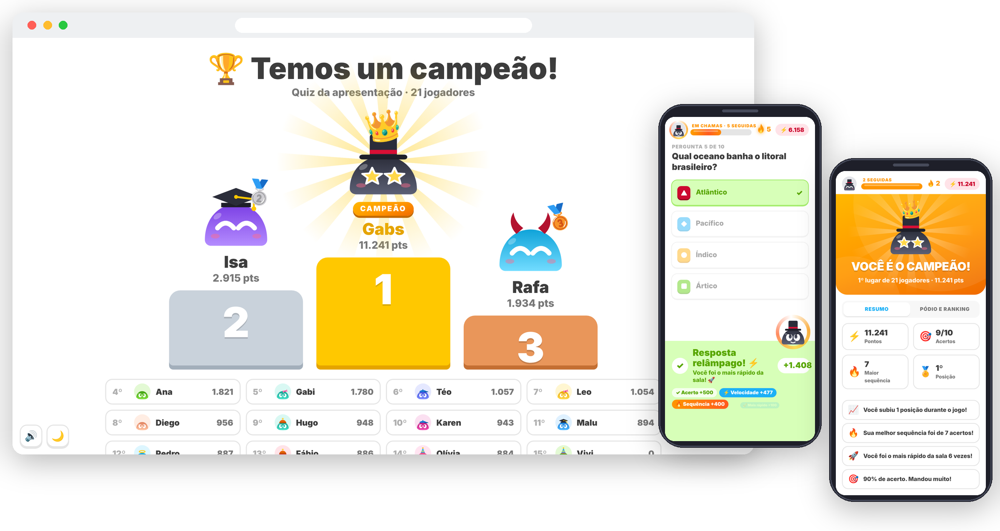
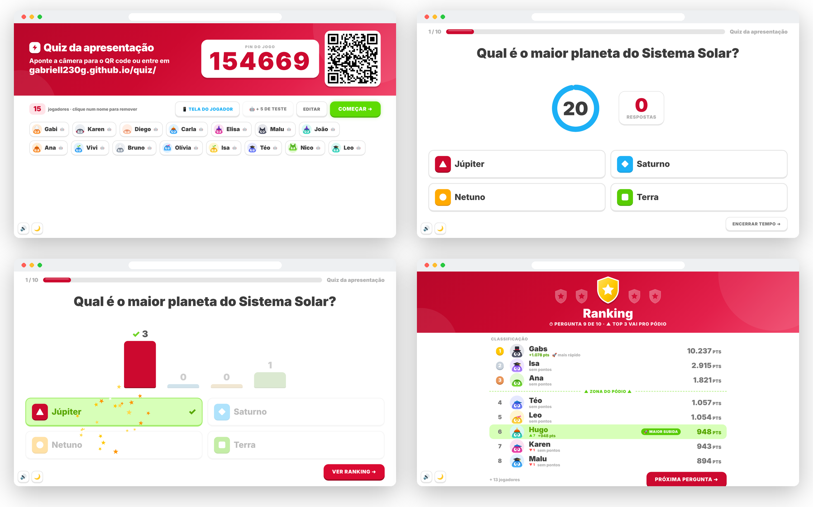
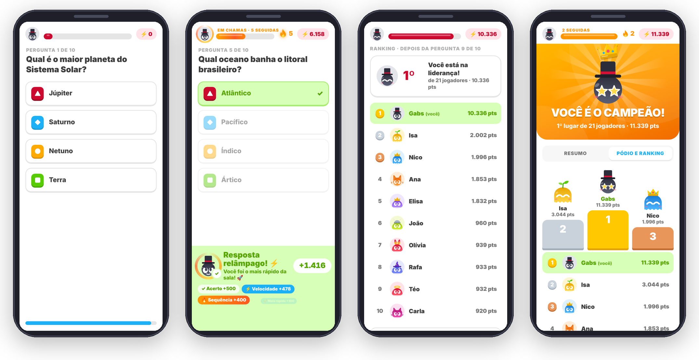
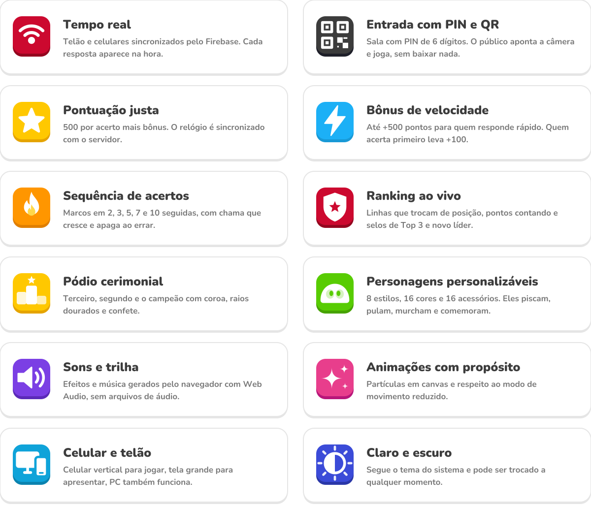
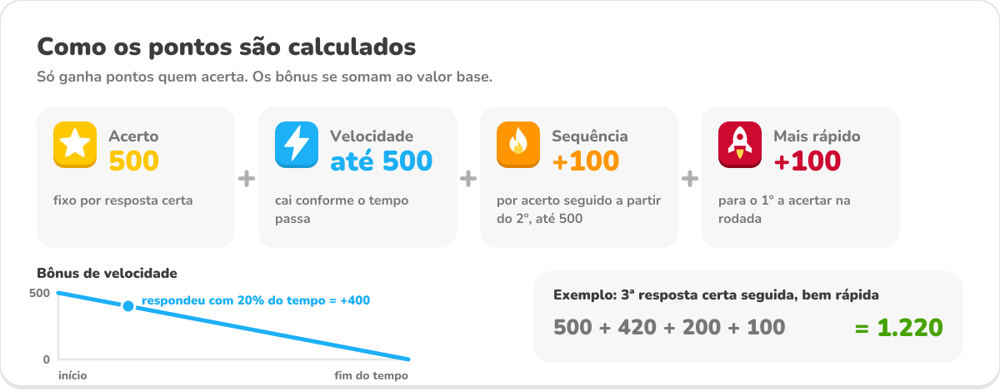
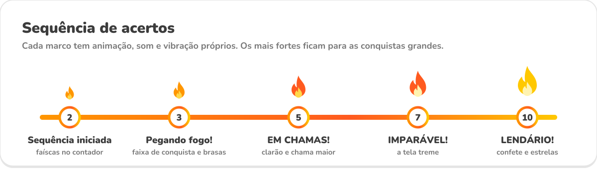
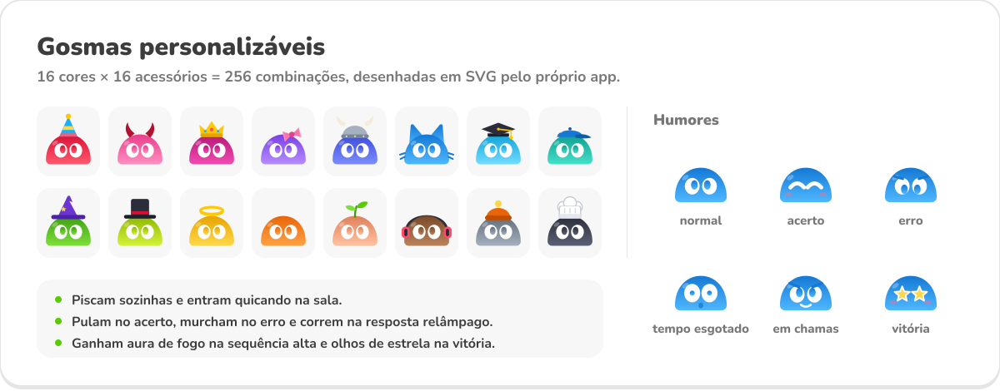
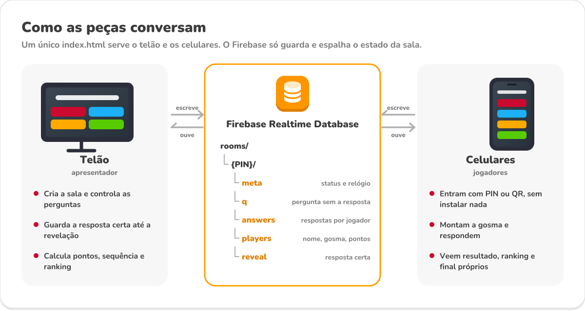
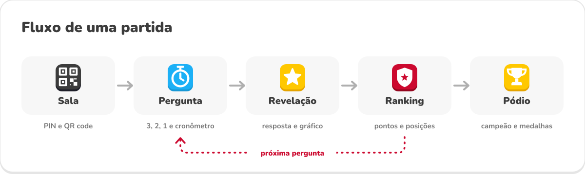

<p align="center">
  
</p>

<p align="center">
  
  
  
  
  
  
  
</p>

<p align="center">
  <a href="https://gabriell230g.github.io/quiz/"><b>Abrir o quiz</b></a>
  &nbsp;·&nbsp;
  <a href="https://gabriell230g.github.io/quiz/#host"><b>Tela do apresentador</b></a>
  &nbsp;·&nbsp;
  <a href="#configurar-o-firebase"><b>Configurar o Firebase</b></a>
</p>

<br>

O **Quiz ao vivo** é um quiz no estilo Kahoot feito para fechar apresentações. O telão mostra as perguntas, o público entra pelo celular com um PIN ou QR code, digita só o nome e joga na hora. A cada rodada aparece a resposta certa, o ranking se reorganiza na frente de todo mundo e, no fim, o pódio revela o campeão.

Tudo roda em **um único `index.html`**: sem instalação, sem cadastro dos jogadores e sem etapa de build. O Firebase Realtime Database sincroniza o telão e os celulares, e um modo de teste local permite ensaiar tudo sem internet.

<p align="center"></p>

## Demonstração

<p align="center">
  <picture>
    <source media="(prefers-color-scheme: dark)" srcset="assets/screens/showcase-dark.png">
    
  </picture>
</p>

**No telão:** sala com PIN e QR code, pergunta com cronômetro, revelação com gráfico de respostas e ranking da rodada.

<p align="center">
  <picture>
    <source media="(prefers-color-scheme: dark)" srcset="assets/screens/telao-dark.png">
    
  </picture>
</p>

**No celular:** responder, ver os pontos ganhos com cada bônus, acompanhar a posição e conferir o pódio final.

<p align="center">
  <picture>
    <source media="(prefers-color-scheme: dark)" srcset="assets/screens/celulares-dark.png">
    
  </picture>
</p>

<p align="center"></p>

## Funcionalidades

<p align="center">
  <picture>
    <source media="(prefers-color-scheme: dark)" srcset="assets/features-dark.svg">
    
  </picture>
</p>

<table>
<tr>
<td width="50%" valign="top">

<br>
**Para quem apresenta**

- Acesso do apresentador protegido por usuário e senha
- Editor de perguntas com 2 a 4 opções e tempo de 10 a 90 segundos, salvo automaticamente no navegador
- Importar e exportar o quiz em JSON
- Retomar a sala por até 12 horas se a aba fechar
- Remover um jogador clicando no nome dele
- Avançar com Espaço, Enter, seta ou passador de slides

</td>
<td width="50%" valign="top">

<br>
**Para quem joga**

- Entra pelo QR code ou pelo PIN, só com o nome
- Monta o próprio personagem: estilo, cor e acessório
- Vê na hora quanto ganhou e de onde veio cada ponto
- Acompanha a posição no ranking a cada rodada
- Recebe conquistas e um resumo da partida no final
- Vibração no celular nos momentos importantes

</td>
</tr>
</table>

<p align="center"></p>

## Pontuação e sequência

<p align="center">
  <picture>
    <source media="(prefers-color-scheme: dark)" srcset="assets/scoring-dark.svg">
    
  </picture>
</p>

O tempo de cada resposta é medido em relação ao relógio do servidor (`.info/serverTimeOffset`), então quem está com o celular adiantado ou atrasado não ganha vantagem. Os valores ficam no objeto `SCORE`, no começo do arquivo, e podem ser ajustados.

| Parte | Valor | Regra |
| :-- | :-- | :-- |
| Acerto | 500 | Só para resposta certa |
| Velocidade | 0 a 500 | Proporcional ao tempo que sobrou |
| Sequência | +100 por acerto seguido | Começa no 2º acerto seguido, até +500 |
| Mais rápido | +100 | Primeiro a acertar na rodada |

<p align="center">
  <picture>
    <source media="(prefers-color-scheme: dark)" srcset="assets/streak-dark.svg">
    
  </picture>
</p>

Depois do 10, um novo marco aparece a cada 5 acertos seguidos. Ao errar, a chama apaga com fumaça e o contador volta a zero. Cada marco dispara uma vez só, sem repetir animação.

<p align="center"></p>

## Ranking e pódio

<table>
<tr>
<td width="33%" valign="top">

<br>
**Ranking da rodada**

As linhas trocam de lugar com animação e os pontos sobem contando. Selos destacam o **novo líder**, quem **entrou no Top 3** e a **maior subida**. A linha tracejada marca a zona do pódio.

</td>
<td width="33%" valign="top">

<br>
**Cerimônia final**

O telão revela o 3º, depois o 2º e, após um rufar de tambores, o campeão com coroa, raios dourados e confete. Do 4º ao 15º aparecem logo abaixo.

</td>
<td width="33%" valign="top">

<br>
**Final no celular**

Cada jogador vê a própria colocação, os pontos, os acertos e a maior sequência, além de conquistas e uma aba com o pódio e o ranking completo.

</td>
</tr>
</table>

<p align="center">
  <picture>
    <source media="(prefers-color-scheme: dark)" srcset="assets/mascots-dark.svg">
    
  </picture>
</p>

<p align="center"></p>

## Tecnologias

<p>
  
  
  
  
  
  
  
  
  
</p>

| Camada | Como foi feito |
| :-- | :-- |
| Interface | HTML, CSS e JavaScript puros, sem framework. Fonte Nunito |
| Tempo real | Firebase Realtime Database (SDK compat 10.12.2) |
| Modo teste | `localStorage` + `BroadcastChannel`, simula o Firebase entre abas |
| Personagens | SVG gerado por código, com 8 estilos, 16 cores e 16 acessórios |
| Efeitos | Um único `<canvas>` para confete, brasas, estrelas e explosões |
| Som | Efeitos e trilha sintetizados com Web Audio API |
| QR code | Biblioteca qrcode-generator embutida no próprio arquivo |
| Acessibilidade | Respeita `prefers-reduced-motion` e o tema do sistema |

<p align="center"></p>

## Arquitetura

<p align="center">
  <picture>
    <source media="(prefers-color-scheme: dark)" srcset="assets/architecture-dark.svg">
    
  </picture>
</p>

<p align="center">
  <picture>
    <source media="(prefers-color-scheme: dark)" srcset="assets/gameflow-dark.svg">
    
  </picture>
</p>

- **O telão é a autoridade da partida.** Ele cria a sala, publica cada pergunta e calcula pontos, sequência e ranking na revelação.
- **A resposta certa não vai para o banco antes da hora.** Os celulares recebem a pergunta sem o gabarito, que só é publicado em `reveal`.
- **Os celulares só escrevem o que é deles:** a resposta em `answers` e o próprio perfil em `players`.
- **A mesma página atende os dois lados.** `index.html` abre a entrada do jogador e `index.html#host` abre o apresentador.

<details>
<summary><b>Estrutura dos dados em <code>rooms/{PIN}</code></b></summary>

```text
rooms/
└── {PIN}/
    ├── meta      status (lobby, question, reveal, board, final), pergunta atual, início, duração
    ├── q         pergunta e opções, sem a resposta certa
    ├── answers/
    │   └── {i}/{jogador}   opção escolhida e tempo em ms
    ├── players/
    │   └── {jogador}       nome, personagem, pontos, sequência, acertos e resultado da rodada
    └── reveal    resposta certa, contagem por opção e o mais rápido
```

</details>

<p align="center"></p>

## Estrutura de arquivos

```text
quiz/
├── index.html            o app inteiro: telas, estilos, lógica, sons e QR code
├── apple-touch-icon.png  ícone para quem salvar o quiz na tela inicial do celular
├── README.md
└── assets/
    ├── banner.svg        capa deste README
    ├── *.svg             diagramas (cada um com versão -dark)
    ├── icons/            ícones das seções
    ├── badges/           selos de tecnologia
    └── screens/          capturas reais do app, claro e escuro
```

A pasta `assets/` só existe para a documentação. O jogo depende apenas do `index.html`.

<p align="center"></p>

## Rodar localmente

**Jeito mais rápido:** dê dois cliques no `index.html`. Ele abre no navegador e já funciona.

**Com servidor local**, para testar em outros aparelhos da mesma rede:

```bash
python -m http.server 8000
```

Depois abra `http://localhost:8000` para jogar e `http://localhost:8000/#host` para apresentar.

**Ensaiar sem internet:** se o Firebase não estiver disponível, o quiz entra sozinho no modo teste, que sincroniza abas do mesmo navegador. Para forçar esse modo, troque no começo do arquivo:

```js
const FORCE_LOCAL_TEST = true;
```

No lobby, o botão **+ 5 de teste** adiciona jogadores robôs que respondem sozinhos, e **Tela do jogador** abre uma aba para você jogar junto.

<p align="center"></p>

## Configurar o Firebase

1. Crie um projeto no [console do Firebase](https://console.firebase.google.com/) e adicione um app **Web**.
2. Em **Build ➜ Realtime Database**, crie o banco.
3. Cole as configurações do app no objeto `FIREBASE_CONFIG`, no começo do `index.html`.
4. Em **Regras**, use:

```json
{
  "rules": {
    ".read": false,
    ".write": false,
    "rooms": {
      "$pin": {
        ".read": true,
        ".write": true
      }
    }
  }
}
```

5. Publique o arquivo (por exemplo no GitHub Pages) e coloque o endereço em `PUBLIC_URL`. Assim o QR code aponta para o site mesmo quando o telão abre o arquivo direto do computador.

**Trocar o acesso do apresentador:** abra o quiz, aperte `F12`, vá em **Console**, rode `quizHash('usuario', 'senha')` e cole o resultado em `ADMIN_HASH`.

> [!NOTE]
> A senha do apresentador é uma trava simples feita no navegador, para evitar que o público abra a tela de controle por engano. Ela não substitui uma autenticação de verdade.

<p align="center"></p>

## Próximas melhorias

Ideias para versões futuras, ainda não implementadas:

- [ ] Login do apresentador com Firebase Authentication
- [ ] Exportar o resultado da partida em CSV
- [ ] Biblioteca com vários quizzes salvos
- [ ] Perguntas com imagem
- [ ] Limpeza automática de salas antigas no banco

<p align="center"></p>

## Créditos

- QR code gerado com [qrcode-generator](https://github.com/kazuhikoarase/qrcode-generator), de Kazuhiko Arase, licença MIT.
- Fonte [Nunito](https://fonts.google.com/specimen/Nunito), licença SIL Open Font License.
- Visual inspirado na linguagem de produtos como o Duolingo, com a paleta vermelha da identidade do projeto.
- Personagens, ícones, diagramas e ilustrações deste README foram criados para o projeto.

Este repositório ainda não define uma licença de código aberto.

<br>

<p align="center">
  <br>
  <sub>Feito para terminar a apresentação no alto.</sub>
</p>
